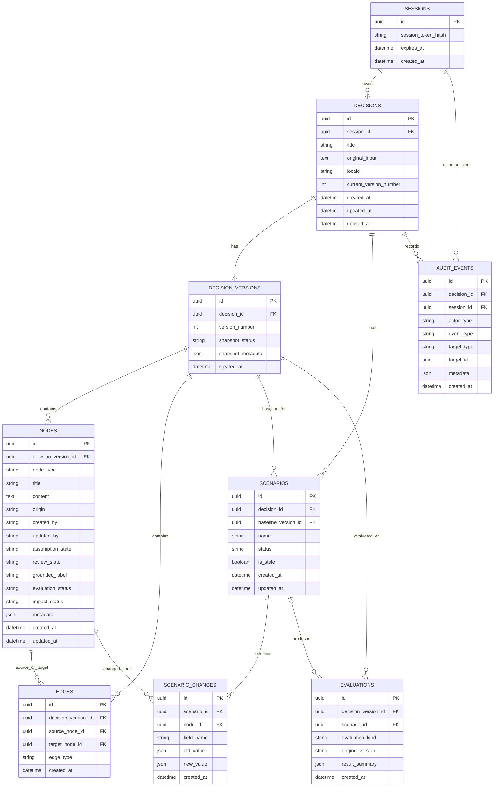

# DecisionMirror — Conceptual ERD

> Version: 1.0.0  
> Status: Proposed logical data model  
> Based on: Reviews 1–10  
>
> This is a conceptual ERD, not a final SQL migration. Several schema decisions remain open and are listed below.

## 1. Entity Relationship Diagram

## 2. Entity responsibilities

| Entity | Responsibility |
|---|---|
| `sessions` | Anonymous session identity and expiry |
| `decisions` | Root decision workspace and owning session |
| `decision_versions` | Immutable baseline snapshots |
| `nodes` | Typed reasoning elements |
| `edges` | Typed relationships between elements |
| `scenarios` | Alternative evaluation context derived from a baseline version |
| `scenario_changes` | User changes applied to a scenario |
| `evaluations` | Recorded deterministic evaluation results |
| `audit_events` | Minimal event history for traceability and security review |

## 3. Relationship semantics

- A session owns zero or more decisions.
- A decision has one or more immutable versions.
- A decision version contains nodes and edges.
- A scenario references exactly one baseline decision version.
- A scenario contains zero or more changes.
- An evaluation refers to a baseline version and optionally a scenario.
- Nodes can be connected by multiple edges.
- Scenario changes refer to nodes in the scenario's baseline version (or an explicitly modeled snapshot).
- Audit events belong to a decision and may identify the session actor.

## 4. Node and edge validation

Node types:
`DECISION`, `ALTERNATIVE`, `CLAIM`, `ASSUMPTION`, `EVIDENCE`, `UNKNOWN`, `COUNTERARGUMENT`, `CONSEQUENCE`.

| Edge | Allowed source | Allowed target |
|---|---|---|
| `SUPPORTS` | EVIDENCE or approved argument node | CLAIM |
| `ATTACKS` | COUNTERARGUMENT | COUNTERARGUMENT |
| `CHALLENGES` | COUNTERARGUMENT | CLAIM |
| `DEPENDS_ON` | CLAIM | ASSUMPTION or CLAIM |
| `ADDRESSES` | UNKNOWN | CLAIM or DECISION |
| `LEADS_TO` | CLAIM or ALTERNATIVE | CONSEQUENCE |

The exact `SUPPORTS` source types should be finalized in the graph validator. If a distinct ARGUMENT node is introduced later, update this contract and migrations consistently.

## 5. Provenance and state constraints

- `origin` is distinct from `created_by` and `updated_by`.
- `assumption_state` is meaningful only for ASSUMPTION nodes.
- `review_state` and `grounded_label` are meaningful only for COUNTERARGUMENT nodes.
- `evaluation_status` is meaningful only for CLAIM nodes.
- `impact_status` is meaningful only for CONSEQUENCE nodes.
- `SYSTEM_INFERENCE` must not independently establish `SUPPORTED`.
- `USER_ACCEPTED` means eligible for evaluation, not proven true.

Use database CHECK constraints where practical, backed by Pydantic/application validation.

## 6. Integrity constraints and indexes

Recommended constraints:
- UUID primary keys and deliberate foreign-key deletion behavior.
- Unique `(decision_id, version_number)`.
- Validate edge endpoints belong to the same decision version.
- Reject `DEPENDS_ON` cycles at write time.
- Reject `LEADS_TO` cycles in MVP unless semantics are explicitly designed.
- Allow `ATTACKS` cycles.
- Use transactions for graph and scenario mutations.
- Use optimistic concurrency with version or ETag.

Recommended indexes:
- `decisions(session_id, updated_at)`
- `decision_versions(decision_id, version_number)`
- `nodes(decision_version_id, node_type)`
- `edges(decision_version_id, source_node_id)`
- `edges(decision_version_id, target_node_id)`
- `scenarios(decision_id, created_at)`
- `scenario_changes(scenario_id, node_id)`
- `evaluations(decision_version_id, created_at)`
- `audit_events(decision_id, created_at)`

## 7. Unresolved data-model decisions

1. **Version storage:** copy nodes/edges for each version, or store immutable snapshots with version membership? Copying is easier to reason about for a small MVP but duplicates data.
2. **Scenario representation:** apply changes as overlays at evaluation time, or materialize a scenario snapshot? Overlay is compact; snapshot can simplify debugging.
3. **Evaluation persistence:** persist immutable evaluation runs (recommended for reproducibility) or recompute on read?
4. **Deletion:** hard-delete immediately or soft-delete before asynchronous purge? User-facing promises must match actual behavior.
5. **Audit retention:** audit metadata must not preserve decision text after deletion.
6. **Session expiry:** exact expiry duration and cleanup mechanism are not selected.

## 8. Recommended MVP choice

For an MVP with a graph soft cap around 40 nodes:
- PostgreSQL relational tables.
- Immutable decision versions.
- Scenario changes as overlays against a baseline version initially.
- Persist evaluation runs with engine version and compact result summary.
- NetworkX computation in-memory per request.
- Transactionally save scenario changes and evaluation results.
- Add materialized scenario snapshots only if measurements or debugging justify them.

This is a recommendation, not a final SQL schema. Validate against baseline immutability, scenario isolation, deletion behavior, and deterministic reproducibility before migrations.
